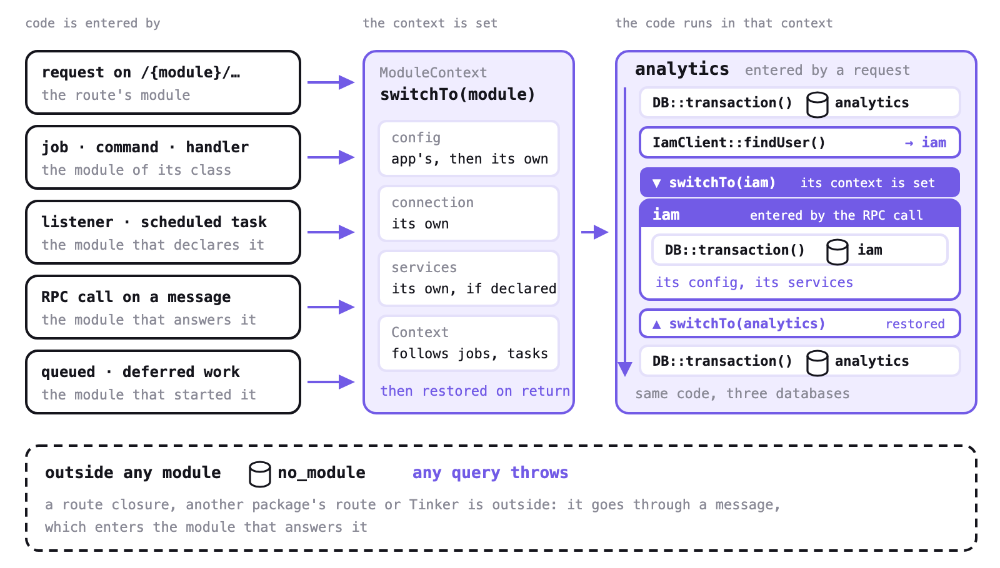

# Its settings and services

A module's code stays ordinary Laravel: `User::query()`, `DB::transaction()`, `Cache::get()`, with no
connection or setting named anywhere. Whichever way its code starts (a request, a job, a command, an
event, a call from another module), it runs with its own settings, its own database and its own
services, and the previous module's come back afterwards.



Outside any module there is no default connection: any query throws a `ModuleException`. Every connection
belongs to a module.

## Settings, database, services

Each module runs with its own settings. A module sets them in its own `config/` folder, over the
application's: `apps/Iam/config/database.php` gives `iam` its connection, `apps/Iam/config/cache.php`
its cache. While iam's code runs, `config()` returns iam's values.

### The database

`DB::table('users')` and a model with no connection use the module's own connection: nothing to do.

### Other services

Laravel builds the cache, the mailer, the filesystem and most package clients once, from the
settings it finds the first time, then reuses them. To give each module its own, built from its own
settings, list them in `config/distributable.php`:

```php
'per_module' => [
    'cache', 'cache.store', 'mail.manager', 'mailer', 'filesystem', ReportBuilder::class,
],
```

Each one is listed under the name it is registered with, the one given to `singleton()`:

- the cache: `cache` and `cache.store`;
- the mailer: `mail.manager` and `mailer`;
- the disks: `filesystem`;
- a package's service: the name its provider gives it;
- a singleton of yours that receives one of these in its constructor, such as `ReportBuilder`:
  its class name. Unlisted, it keeps the cache of the module it was first built in.

## When it applies

You don't switch anything yourself. A module's settings apply to a request on its routes, a job, a
command, an event handler, a listener it declares, a scheduled task, a call from another module, a
queued closure, `defer()`, `Concurrency::run()` and `Octane::concurrently()`. The full list is in
[Its database](./databases#models-and-transactions).

When analytics calls `IamClient::findUser()` and iam runs in the same process, iam's handler runs
with iam's settings, and analytics' come back when the method returns.

## Work that runs later

For a closure of yours that runs later or elsewhere, `ModuleContext::bind()` keeps the current
module with it:

```php
$task = app(\Distributable\Context\ModuleContext::class)->bind(fn () => Report::rebuild());
```

`ModuleContext::current()` returns the module running now, or `null` outside any module.

## Reaching another module

A module can't run its code with another module's settings: `within()`, called from another
module's code or from the foundation, throws a `ModuleException`. The way into another module is
its messages, see [Calling another module](./rpc).
